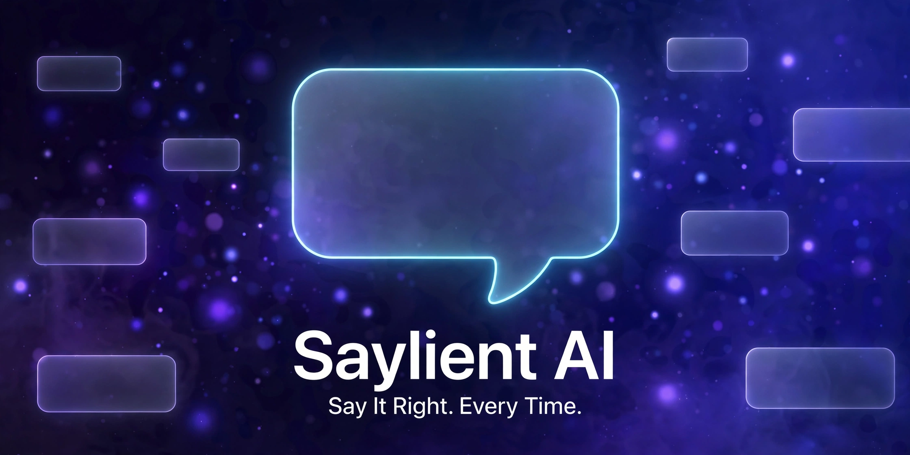
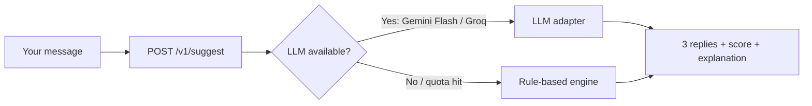

<p align="center">
  <a href="https://github.com/arsalanahmedk/saylient_ai/actions/workflows/ci.yml"></a>
  
  
  
  
</p>

<h3 align="center">Say It Right. Every Time.</h3>

<p align="center">
Saylient AI is an AI assistant for freelancers that rewrites difficult client
messages — late payments, deadline talks, scope creep, disputes — into polite,
clear and professional replies, and explains <i>why</i> the rewrite works,
using Brown &amp; Levinson's Politeness Theory (1987).
</p>

---

## ✨ See it in action

**You write:**

> "You still haven't paid invoice #1048. Pay now."

**Saylient suggests** (scenario: `late_payment`, strategy: `negative_politeness`, score: 80/100):

| Tone | Reply |
|---|---|
| 😊 Polite | "Hi! Just a friendly reminder that invoice #1048 is still pending. Could you please let me know when it will be processed? Thank you!" |
| 🤝 Friendly | "Hey! Hope you're doing well — quick nudge on invoice #1048. Whenever you get a chance to send the payment, I'd really appreciate it." |
| 💼 Firm | "Hi, following up on invoice #1048, which is now overdue. Please arrange payment at your earliest convenience so we can keep the project on track." |

Every suggestion also explains the strategy it used — so you learn the skill, not just copy the text.

## 🚀 What it does

- **3 tones, 1 click** — polite, friendly and firm rewrites for any tricky message
- **Knows the situation** — detects the scenario (late payment, scope creep, rude client…) and the face-threat level
- **Explains itself** — every reply comes with the politeness strategy behind it
- **Auto-analyze (planned)** — the extension will read the conversation and suggest replies by itself. It **never** sends anything without your click
- **Works offline too** — a rule-based engine answers instantly when no LLM is available

## 🧠 How it works



- **Live inference:** Google Gemini Flash (primary, free tier) with Groq `gpt-oss-120b` as fallback — one OpenAI-compatible adapter, no vendor lock-in. See [`docs/LLM_CHOICE.md`](docs/LLM_CHOICE.md).
- **Fine-tuned model (the research):** Qwen2.5-3B-Instruct + QLoRA, trained on our own politeness dataset — the FYP contribution. See [`ml/training/train_qlora.py`](ml/training/train_qlora.py).
- **Always honest fallback:** if the LLM is down or rate-limited, the rule engine answers and the response says so (`source: rule_based`, `llm_status`).

## 🗃️ The dataset — 99,990 rows

| Split | Rows | Per intent |
|---|---:|---:|
| Train | 84,986 | 7,727 |
| Validation | 7,502 | 682 |
| Test | 7,502 | 682 |
| **Total** | **99,990** | **9,090** |

10 scenarios × 11 intents, built from 700 hand-written seeds + 165 templates.
Keyword baseline on the full test set (the bar the fine-tuned model must beat):
intent F1 **0.392**, strategy F1 **0.447**. See [`ml/data/README.md`](ml/data/README.md).

## ⚡ Quick start

```bash
cp .env.example .env          # fill in values, never commit .env
# LLM (optional): set AI_PROVIDER=gemini + AI_API_KEY from Google AI Studio (free, no card)
# Without a key the API still runs — rule-based only.
cd apps/api && pip install -r requirements.txt && uvicorn app.main:app --reload
# API at http://127.0.0.1:8000 — GET /health, POST /v1/suggest, POST /v1/analyze
```

```bash
cd apps/api && pip install -e .[dev] && pytest -q   # 60 tests, incl. golden set 12/12
```

```bash
# Web app (Phase 4, Neumorphism design, no build step)
# 1) Backend:
cd apps/api && uvicorn app.main:app --reload   # API on :8000 (rule-based without an AI key)
# 2) Frontend:
python3 -m http.server 5173 --directory apps/web
# open http://localhost:5173 — full site: animated hero, live demo,
# Features / Theory (overview) / About / Extension / Log in pages.
# The demo is wired to the real API (GET /health, POST /v1/suggest,
# POST /v1/analyze, configured in apps/web/config.js, default
# http://localhost:8000, overridable with ?api=<url>); when the API
# is down it falls back to the built-in demo — never an error.
# The Extension tab is honest "Coming soon": the Phase 5 extension
# build does not exist yet, so there is no download link.
```

```bash
# Try it
curl -X POST http://127.0.0.1:8000/v1/suggest \
  -H "Content-Type: application/json" \
  -d '{"text": "You still haven'"'"'t paid invoice #1048. Pay now."}'
```

**API contract:** request field `text` (max 4,000 chars), optional free-text `goal`;
replies are `{tone, text}` objects + `suggestion_id` + integer `score`; 16 KB body
cap. Auth, history, settings, feedback, export and account deletion are
**planned for a later phase, not implemented** — the API is stateless for now.
Full spec: [`docs/API_SPEC.md`](docs/API_SPEC.md) and [`docs/openapi.yaml`](docs/openapi.yaml).

## 📁 Project structure

```
saylient_ai/
├── apps/
│   ├── api/            # FastAPI backend — rule engine, LLM adapter, tests (CI ✅)
│   ├── web/            # Web app — Neumorphism frontend (Phase 4 ✅, static, no build step)
│   └── extension/      # Chrome extension (side panel) — placeholder until Phase 5
├── docs/               # PRD, SRS, architecture, security, API spec, roadmap
├── ml/
│   ├── data/           # Dataset v3 — 99,990 rows + generator + splits
│   ├── evaluation/     # Metrics + baselines
│   └── training/       # QLoRA training script + Colab notebook
└── packages/shared/    # Shared types (later)
```

## 🗺️ Roadmap

- [x] **Phase 0–2** — API baseline, rule engine, LLM adapter, seed dataset, CI
- [x] **Dataset v3** — 99,990 rows, baselines measured
- [ ] **Phase 3** — Fine-tune Qwen2.5-3B (QLoRA) on Colab T4 — *waiting on GPU*
- [x] **Phase 4** — Web app (Neumorphism design, static frontend in `apps/web/` — full site: animated hero, live demo wired to the real API, Features / Theory / About / Extension / Log in pages; open it directly or serve it; calls the API when available, built-in demo otherwise)
- [ ] **Phase 5** — Chrome extension with auto-analyze + auto-suggest (never auto-send)

## 📚 Documentation

Start with [`docs/PRD.md`](docs/PRD.md), then
[`docs/ARCHITECTURE.md`](docs/ARCHITECTURE.md),
[`docs/SECURITY.md`](docs/SECURITY.md),
[`docs/LLM_CHOICE.md`](docs/LLM_CHOICE.md) and
[`docs/ROADMAP.md`](docs/ROADMAP.md).

## 👥 Team

[Team member names, registration numbers] | Supervisor: [Name] | Collaborating department: English Linguistics

## 📄 License

MIT, see [`LICENSE`](LICENSE).
